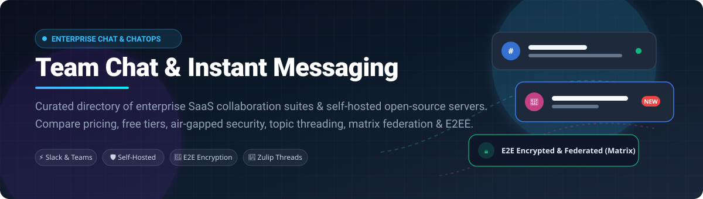

<p align="center">
  
</p>

# Awesome Team Chat & Instant Messaging 💬🚀

<a href="https://github.com/ishandutta2007/Awesome-Awesome-Awesome"></a><a href="https://discord.gg/jc4xtF58Ve"></a>
[](https://github.com/ishandutta2007/Awesome-Awesome-Awesome)
[](LICENSE)
[](CONTRIBUTING.md)
[](https://github.com/ishandutta2007)
<a href="https://github.com/ishandutta2007"></a>

> **A curated directory of top SaaS enterprise collaboration platforms and production-grade open-source team chat servers.**  
> Explore channel-based messaging, ChatOps integrations, topic-threaded discussions, Matrix federation, air-gapped deployments, and self-hosted privacy alternatives.

---

## 📑 Table of Contents

- [📊 Sector Overview & Market Dynamics](#-sector-overview--market-dynamics)
- [🏢 SaaS & Hosted Platforms](#-saas--hosted-platforms)
- [💻 Open-Source GitHub Projects](#-open-source-github-projects)
  - [⭐ Top Open-Source Chat Repositories](#-top-open-source-chat-repositories-ranked-by-stars)
  - [🛠️ Deep-Dive Architectural Breakdown](#%EF%B8%8F-deep-dive-architectural-breakdown)
- [⚖️ Architecture & Selection Guide](#%EF%B8%8F-architecture--selection-guide)
- [🤝 How to Contribute](#-how-to-contribute)
- [💖 Support & Sponsorship](#-support--sponsorship)
- [⭐ Star History](#-star-history)
- [📜 Disclaimer & Operational Realities](#-disclaimer--operational-realities)

---

## 📊 Sector Overview & Market Dynamics

The global team collaboration and team chat software market is estimated at **$31.5 Billion** and is projected to expand to **over $55 Billion by 2030** (CAGR ~11.8%). 

The sector exhibits **high concentration with an oligopolistic "winner-take-most" dynamic** at the enterprise enterprise-suite layer (led by **Microsoft Teams** through Office 365 bundling and **Salesforce / Slack** for developer/ChatOps workflows), counterbalanced by a **rapidly growing, fragmented ecosystem** of specialized, privacy-first, and self-hosted open-source alternatives (such as Rocket.Chat, Mattermost, and Matrix/Element) responding to strict data residency, compliance, and air-gapped sovereign requirements.

---

## 🏢 SaaS & Hosted Platforms

The table below lists leading commercial SaaS team messaging platforms sorted in descending order by parent company size (Market Capitalization / Valuation).

| Product / Platform 🏷️ | Company Valuation / Revenue 💰 | Starting Pricing Tier 💵 | Free Tier Limits / Free Trial Policy 🎁 | Key Strengths & Use Cases ⚡ |
| :--- | :--- | :--- | :--- | :--- |
| **[Microsoft Teams](https://www.microsoft.com/en-us/microsoft-teams)** | ~$3.1 Trillion Market Cap ($245B+ ARR) | **$4.00/user/month** (Microsoft Teams Essentials) or bundled in M365 Business Basic ($6.00/user/month) | **Free Forever**: 60-min group meeting limit, up to 100 participants per meeting, 5 GB cloud storage per user, uncapped 1:1 chat history. | Deep native integration with Word, Excel, PowerPoint, OneDrive, and SharePoint; comprehensive enterprise security (Purview, GCC High). |
| **[Google Chat](https://workspace.google.com/)** | ~$2.1 Trillion Market Cap ($350B+ ARR) | **$6.00/user/month** (Google Workspace Business Starter) | **14-day Free Trial** (full access up to 10 users). Free for personal Google accounts with basic 15 GB shared Drive storage. | Native integration into Gmail, Google Drive, Docs, and Google Meet; smart canvas and space collaboration for Workspace teams. |
| **[Cisco Webex](https://www.webex.com/)** | ~$220 Billion Market Cap ($54B ARR) | **$12.00/user/month** (Webex Meet Plan; Suite at $22.50/user/month) | **Free Forever**: 40-min meeting limit, up to 100 attendees, 1:1 and group messaging, local recording only, 1 GB storage. | Carrier-grade VoIP, Webex Room hardware integration, FedRAMP Moderate certification, and high-security compliance controls. |
| **[Slack](https://slack.com/)** (Salesforce) | ~$270 Billion Market Cap ($35B ARR) | **$7.25/user/month** (Slack Pro, billed annually; $8.75 monthly) | **Free Forever**: 90-day searchable message and file history, 10 app integrations, 1:1 audio/video huddles with canvas notes. | Premier developer ecosystem, 2,600+ third-party integrations, granular notification controls, and Block Kit custom workflow builder. |
| **[Discord](https://discord.com/)** | ~$15 Billion Valuation (~$600M ARR) | **$2.99/month** (Nitro Basic) or **$9.99/month** ($99.99/yr Nitro full) | **Free Forever**: Unlimited message history, unlimited channels, up to 25 video participants, 25 MB upload limit, 64 kbps audio quality. | Low-latency voice channels, massive community engagement, server roles/permissions, screen sharing, and bots. |
| **[Chanty](https://www.chanty.com/)** | ~$15 Million Valuation (~$3M ARR) | **$3.00/user/month** (Chanty Business, billed annually; $4.00 monthly) | **Free Forever**: Up to 5 team members, 10 public/private channels, 20 GB storage per team, 90-day search history, 1:1 audio calls. | Clean lightweight UI, built-in Kanban task management board, Teambook hub, and integrated AI communication helper for small teams. |

> *Note: Legacy solutions like Atlassian HipChat were officially sunset in 2019 in favor of Slack/Teams migrations.*

---

## 💻 Open-Source GitHub Projects

Open-source team chat software has matured into enterprise-grade software capable of air-gapped deployments, end-to-end encryption (E2EE), zero-trust access, and federated protocols.

### ⭐ Top Open-Source Chat Repositories (Ranked by Stars)

| Repository & Platform 📦 | GitHub Stars 🌟 | License 📄 | Primary Stack 💻 | Architecture Highlights 🔍 |
| :--- | :--- | :--- | :--- | :--- |
| **[Rocket.Chat](https://github.com/RocketChat/Rocket.Chat)** | [](https://github.com/RocketChat/Rocket.Chat/stargazers) | MIT Core / EE | TypeScript, Node.js, MongoDB | Omnichannel customer hub, Matrix federation, compliance center, air-gapped on-premise installation. |
| **[Mattermost](https://github.com/mattermost/mattermost)** | [](https://github.com/mattermost/mattermost/stargazers) | Source-Available / MIT (Client) | Go, React, PostgreSQL | Single lightweight Go binary, Slack-compatible webhooks, Playbooks incident response, and DevOps ChatOps. |
| **[Zulip](https://github.com/zulip/zulip)** | [](https://github.com/zulip/zulip/stargazers) | Apache-2.0 | Python, Django, PostgreSQL | Unique stream and topic-based threading model; prevents conversation context loss in distributed async teams. |
| **[Element Web](https://github.com/element-hq/element-web)** | [](https://github.com/element-hq/element-web/stargazers) | AGPL-3.0 | TypeScript, React, Matrix | Flagship Matrix client with default auditing-grade End-to-End Encryption (Olm/Megolm) and cross-server federation. |
| **[Tinode](https://github.com/tinode/chat)** | [](https://github.com/tinode/chat/stargazers) | GPL-3.0 | Go, gRPC, MySQL/RethinkDB | High-performance messaging daemon and instant messaging server built for extreme speed and low RAM footprint. |
| **[Matrix Synapse](https://github.com/matrix-org/synapse)** | [](https://github.com/matrix-org/synapse/stargazers) | AGPL-3.0 | Python, Twisted, PostgreSQL | The reference homeserver implementation for the decentralized Matrix communications protocol. |
| **[Tailchat](https://github.com/msgbyte/tailchat)** | [](https://github.com/msgbyte/tailchat/stargazers) | Apache-2.0 | TypeScript, Node.js, Microservices | "No limits" modern Discord/Slack hybrid alternative with microkernel plugin architecture and web3 capabilities. |
| **[Revolt Backend](https://github.com/revoltchat/backend)** | [](https://github.com/revoltchat/backend/stargazers) | AGPL-3.0 | Rust, Actix-web, MongoDB | High-throughput open-source user-first chat platform engineered in Rust as a privacy-friendly Discord alternative. |
| **[Nextcloud Talk](https://github.com/nextcloud/spreed)** | [](https://github.com/nextcloud/spreed/stargazers) | AGPL-3.0 | PHP, JavaScript, WebRTC | Integrated self-hosted team chat, screen sharing, and audio/video conferencing engine for the Nextcloud ecosystem. |

---

### 🛠️ Deep-Dive Architectural Breakdown

#### 1. Full-Featured Enterprise Chat Servers
- **[Rocket.Chat](https://github.com/RocketChat/Rocket.Chat)**: The undisputed open-source heavyweight for regulated environments. Offers full omnichannel routing (linking WhatsApp, Instagram, LiveChat, and Email into a single console), complete air-gapped support, data loss prevention (DLP), and Matrix federation.
  - *Operational Note*: Community edition caps hosted mobile push gateway notifications at 10,000 pushes/month.
- **[Mattermost](https://github.com/mattermost/mattermost)**: Crafted explicitly for technical and engineering teams. Runs as a hyper-efficient single Go binary connected to PostgreSQL. Features native integration with Jira, GitLab, GitHub, and Jenkins, alongside automated Playbooks for SRE incident response.
  - *Operational Note*: Free Team Edition provides uncapped database history, but its free TPNS push notification proxy is not SLA-backed for high-volume enterprise production.

#### 2. Asynchronous Thread-First Platforms
- **[Zulip](https://github.com/zulip/zulip)**: Eliminates message fatigue by organizing streams into distinct explicit subjects/topics. Team members can easily catch up on discussions days later without scrolling through unrelated chatter.
  - *Operational Note*: Requires team culture discipline to maintain clean topic taxonomy, but yields superior long-term organizational knowledge retention.

#### 3. Decentralized & E2E Encrypted Ecosystems
- **[Element (Matrix)](https://github.com/element-hq/element-web)** & **[Matrix Synapse](https://github.com/matrix-org/synapse)**: Enables cross-organizational communication where external vendors, partners, and internal staff collaborate across independent, federated homeservers without sharing tenant credentials.
  - *Operational Note*: Requires running or procuring a dedicated Matrix homeserver (Synapse or Dendrite) with PostgreSQL tuning and a Sygnal push gateway.

#### 4. Community & Discord Alternatives
- **[Tailchat](https://github.com/msgbyte/tailchat)**: Highly extensible chat platform featuring a plug-and-play microkernel design. Ideal for organizations seeking a private community server with minimal operational baggage.
- **[Revolt](https://github.com/revoltchat/backend)**: Blazing-fast Discord alternative powered by a Rust backend. Perfect for privacy-focused gaming clans, open-source communities, and student teams.

---

## ⚖️ Architecture & Selection Guide

```
                      Do you require 100% on-premise / data sovereignty?
                                     │
                    ┌────────────────┴────────────────┐
                   YES                                NO
                    │                                 │
   Need E2EE or cross-org federation?      Already on M365 or Workspace?
        │                       │               │                 │
       YES                      NO             YES                NO
        │                       │               │                 │
 ┌──────────────┐     Topic-first or DevOps?  Teams / Meet   Slack / Discord
 │Element/Matrix│        │              │
 └──────────────┘      Zulip       Mattermost /
                                   Rocket.Chat
```

- **Choose Slack** if your organization runs heavily on third-party SaaS tools, custom bots, and rapid ChatOps integrations.
- **Choose Microsoft Teams** if you already subscribe to Microsoft 365, need seamless SharePoint file co-authoring, and want zero incremental licensing overhead.
- **Choose Mattermost** if you are a DevOps or engineering organization seeking a self-hosted Slack experience with minimum operational footprint.
- **Choose Rocket.Chat** if you need omni-channel customer support, call center routing, and air-gapped on-premise regulatory compliance.
- **Choose Zulip** if your team is globally distributed, operates asynchronously across time zones, and values durable discussion threads over real-time chatter.
- **Choose Element / Matrix** if zero-trust audited End-to-End Encryption and cross-organization federated rooms are strict non-negotiables.

---

## 🤝 How to Contribute

Contributions are warmly welcomed! Help us keep this directory exhaustive and up to date:

1. **Fork the Repository** to your personal GitHub account.
2. **Add or Update Entries** in `README.md` following the tabular format and objective tone.
3. **Include Specific Data**: Verify exact pricing tiers, free tier constraints, licenses, and official repository links.
4. **Submit a Pull Request** with a succinct description of changes.

---

## 💖 Support & Sponsorship

Thank you for visiting and using this curated list! 🌟  
If you find this project valuable and want to support continued updates, maintenance, and curation of open-source tools:

- ⭐ **Star this repository** to show your appreciation and help others discover it.
- 🍴 **Fork and share** it with your engineering and DevOps teammates.
- ☕ **Buy a coffee / Sponsor**: If you'd like to support ongoing development, consider sponsoring via the [GitHub Sponsors Dashboard](https://github.com/sponsors/ishandutta2007).

Your support is deeply appreciated! 🙌

---

##  Star History
[](https://star-history.dera.page/#ishandutta2007/Awesome-Team-Chat-Instant-Messaging&type=date&legend=top-left)

---

## 📜 Disclaimer & Operational Realities

- This repository is a community-curated directory intended for system architects, IT leaders, and engineering teams.
- **Self-Hosting Trade-offs**: While self-hosted platforms provide absolute data sovereignty, you assume full responsibility for database backups, SSL certificates, security patches, high availability, and **mobile push notification gateways** (e.g., APNs/FCM limits on free tiers).
- Verify licensing restrictions for commercial redistribution before self-hosting (e.g., MIT, AGPL-3.0, or Business Source Licensing).
